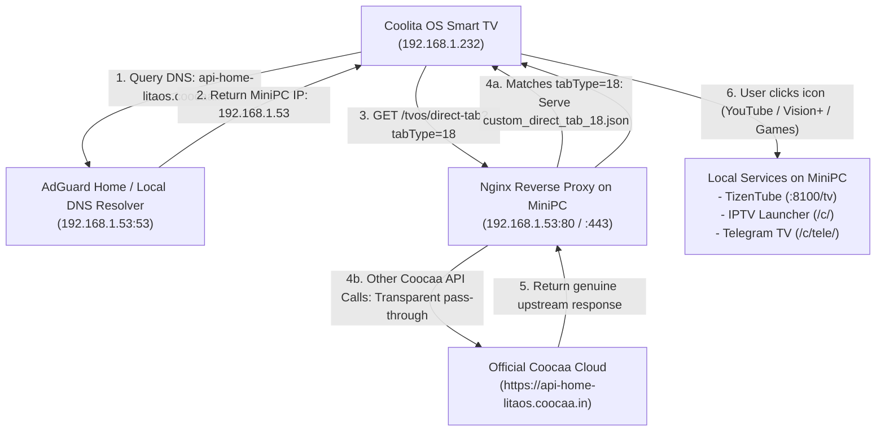

# Complete Guide: Customizing Coolita OS Smart TV Main Menu & Redirecting Apps (Single-Domain API Interception Method)

This guide documents the cleanest, most efficient, and robust method to customize the app bar / main menu icons on **Coolita OS** Smart TVs (Coocaa / Skyworth).

This method is **significantly simpler** than legacy per-application DNS spoofing and 302 HTTP redirection techniques:
1. **Single DNS Rewrite**: Only one cloud domain (`api-home-litaos.coocaa.in`) is redirected to your local server (e.g., MiniPC / Home Server).
2. **Single URL Intercept**: Nginx intercepts only one endpoint: `/tvos/direct-tab?tabType=18`.
3. **Full Visual & Target Control**: Every app icon on the TV's main menu can point directly to local web services (such as TizenTube for ad-free YouTube TV, IPTV Launcher, or Telegram TV), complete with custom **2:1 landscape** full-bleed banners.
4. **Zero Impact on Native TV Features**: All other Coocaa cloud API calls are transparently reverse-proxied to the genuine Coocaa upstream servers on the internet.

---

## 1. Architecture & How It Works

Coolita OS utilizes a dual-runtime architecture. The main application row (which displays when pressing the **[INPUT]** button or when accessing the Home dashboard) is rendered by the internal Chromium web engine (`file:///skyworth/app/web/home/Home.html`).

Upon system launch or menu activation, the TV browser requests the application list configuration from Coocaa's cloud service via `direct-tab?tabType=18`. By placing a local Linux server (MiniPC) as a transparent reverse proxy (MITM), we selectively replace this specific JSON payload with our own customized application catalogue.



---

## 2. Prerequisites & Hardware Requirements

1. **Coolita OS Smart TV** (Coocaa / Skyworth):
   - Connected to your home local network (Wi-Fi or Ethernet).
2. **Local Linux Server** (MiniPC, Raspberry Pi, Home Server, or local VM):
   - Static local IP recommended (e.g., `192.168.1.53`).
   - **Nginx Web Server**: Serves as the HTTPS/HTTP reverse proxy and image host.
   - **Local DNS Resolver**: AdGuard Home, Pi-hole, or OpenWrt dnsmasq.
   - **OpenSSL**: For creating a self-signed TLS certificate to handle TV HTTPS handshakes.

---

## 3. Step 1: Create Self-Signed TLS Certificate for Nginx

The TV communicates with Coocaa API servers over HTTPS (port 443). Nginx must present a valid TLS certificate during the handshake:

```bash
mkdir -p /etc/nginx/ssl
openssl req -x509 -nodes -days 3650 -newkey rsa:2048 \
  -keyout /etc/nginx/ssl/my.key \
  -out /etc/nginx/ssl/my.crt \
  -subj "/CN=api-home-litaos.coocaa.in" \
  -addext "subjectAltName=DNS:api-home-litaos.coocaa.in,DNS:*.coocaa.in,DNS:*.coocaa.asia"
```

---

## 4. Step 2: Prepare Custom Banner Images (2:1 Landscape Ratio)

Coolita OS uses a strict **2:1 landscape aspect ratio** for main menu app cards.
- **Recommended Resolution**: `800 x 400 px` (ultra-sharp on 1080p and 4K panels) or `400 x 200 px`.
- **Styling**: Full-bleed design (solid or gradient background filling the entire rectangle without thin empty margins).

Save the banner assets on your web server (e.g., `/var/www/html/c/assets/`):
1. **Telegram TV Banner**: `/var/www/html/c/assets/telegram_banner.png` (Telegram blue gradient `#24A1DE` + official white paper-plane logo).
2. **IPTV Launcher Banner**: `/var/www/html/c/assets/iptv_banner.png` (Dark slate/indigo navy `#0f172a` + modern TV/Live icon in cyan).

> [!TIP]
> You can generate high-resolution banners using Python Pillow or graphic editors like Photoshop/Canva at `800x400`. Verify that the images are accessible in your browser at `http://192.168.1.53/c/assets/telegram_banner.png`.

---

## 5. Step 3: Configure `custom_direct_tab_18.json`

This file overrides Coocaa's cloud response whenever the TV requests the application row. Save this file at `/var/www/html/custom_direct_tab_18.json`.

Key parameters inside `extra.block_content_info`:
- **`title`**: Display title shown beneath or alongside the card.
- **`app_info.app_url`**: Destination URL launched when the user clicks the card.
- **`action`**: JSON string containing the launch action executed by the TV webview.
- **`imgs.poster.images`**: Array containing the image banner URL (local HTTP URLs from your MiniPC are fully supported).
- **`cycle_time`**: Must be set to `0` to prevent client-side delay.
- **`md5`**: Set to the current Unix epoch timestamp string (e.g., `"1795100528"`) so the TV detects a new version and invalidates its internal IndexedDB cache immediately.

### Complete Production Template (`/var/www/html/custom_direct_tab_18.json`):

```json
{
  "code": 0,
  "msg": "success",
  "data": {
    "cycle_time": 0,
    "homepage_id": 10553,
    "homepage_name": "印尼-正式-TV",
    "md5": "1795100528",
    "refresh_info": null,
    "sink_size": 1,
    "tab_config": "{}",
    "tab_id": 1050574,
    "tab_name_en": "APPS",
    "content": {
      "bg": "",
      "contents": [
        {
          "bg": "",
          "contents": [
            {
              "type": "Block",
              "id": "105057488",
              "focusable": 1,
              "width": 410,
              "height": 205,
              "x": 0,
              "y": 0,
              "extra": {
                "title": "YouTube",
                "block_content_info": {
                  "title": "YouTube",
                  "content_status": 1,
                  "app_info": {
                    "app_url": "http://192.168.1.53:8100/tv",
                    "supplier": "custom"
                  },
                  "action": "{\"avod\": false, \"bywhat\": \"action\", \"dowhat\": \"startActivity\", \"params\": {\"id\": \"303\", \"url\": \"http://192.168.1.53:8100/tv\"}, \"byurl\": \"http://192.168.1.53:8100/tv\"}",
                  "imgs": {
                    "poster": {
                      "images": [
                        "https://res-litaos.coocaa.in/virgo/img/072/2120/tr3447062108-icc-200.png"
                      ]
                    }
                  }
                }
              }
            },
            {
              "type": "Block",
              "id": "105057489",
              "focusable": 1,
              "width": 410,
              "height": 205,
              "x": 450,
              "y": 0,
              "extra": {
                "title": "Browser",
                "block_content_info": {
                  "title": "Browser",
                  "content_status": 1,
                  "app_info": {
                    "app_url": "https://coolita.com/coobrowser/home.html",
                    "supplier": "custom"
                  },
                  "action": "{\"avod\": false, \"bywhat\": \"action\", \"dowhat\": \"startActivity\", \"params\": {\"id\": \"536\", \"url\": \"https://coolita.com/coobrowser/home.html\"}}",
                  "imgs": {
                    "poster": {
                      "images": [
                        "https://res-litaos.coocaa.in/virgo/img/third/new/20260907/20260907131635856443.jpg"
                      ]
                    }
                  }
                }
              }
            },
            {
              "type": "Block",
              "id": "105057490",
              "focusable": 1,
              "width": 410,
              "height": 205,
              "x": 900,
              "y": 0,
              "extra": {
                "title": "Coolita Channel",
                "block_content_info": {
                  "title": "Coolita Channel",
                  "content_status": 1,
                  "app_info": {
                    "app_url": "http://192.168.1.53/c/index.html",
                    "supplier": "custom"
                  },
                  "action": "{\"avod\": false, \"bywhat\": \"action\", \"dowhat\": \"startActivity\", \"params\": {\"id\": \"598\", \"url\": \"http://192.168.1.53/c/index.html\"}}",
                  "imgs": {
                    "poster": {
                      "images": [
                        "https://res-litaos.coocaa.in/virgo/img/third/new/20240202/20240202134620883971.png"
                      ]
                    }
                  }
                }
              }
            },
            {
              "type": "Block",
              "id": "105057491",
              "focusable": 1,
              "width": 410,
              "height": 205,
              "x": 1350,
              "y": 0,
              "extra": {
                "title": "Vidio",
                "block_content_info": {
                  "title": "Vidio",
                  "content_status": 1,
                  "app_info": {
                    "app_url": "https://tv.vidio.com",
                    "supplier": "custom"
                  },
                  "action": "{\"avod\": false, \"bywhat\": \"action\", \"dowhat\": \"startActivity\", \"params\": {\"id\": \"352\", \"opentype\": \"Vidio\", \"url\": \"https://tv.vidio.com\"}}",
                  "imgs": {
                    "poster": {
                      "images": [
                        "https://res-litaos.coocaa.in/virgo/img/third/new/20240109/20240109165039925290.png"
                      ]
                    }
                  }
                }
              }
            },
            {
              "type": "Block",
              "id": "105057492",
              "focusable": 1,
              "width": 410,
              "height": 205,
              "x": 0,
              "y": 245,
              "extra": {
                "title": "IPTV Launcher",
                "block_content_info": {
                  "title": "IPTV Launcher",
                  "content_status": 1,
                  "app_info": {
                    "app_url": "http://192.168.1.53/c/",
                    "supplier": "custom"
                  },
                  "action": "{\"avod\": false, \"bywhat\": \"action\", \"dowhat\": \"startActivity\", \"params\": {\"id\": \"593\", \"url\": \"http://192.168.1.53/c/\"}, \"byurl\": \"http://192.168.1.53/c/\"}",
                  "imgs": {
                    "poster": {
                      "images": [
                        "http://192.168.1.53/c/assets/iptv_banner.png?v=1795100528"
                      ]
                    }
                  }
                }
              }
            },
            {
              "type": "Block",
              "id": "105057493",
              "focusable": 1,
              "width": 410,
              "height": 205,
              "x": 450,
              "y": 245,
              "extra": {
                "title": "Telegram",
                "block_content_info": {
                  "title": "Telegram",
                  "content_status": 1,
                  "app_info": {
                    "app_url": "http://192.168.1.53/c/tele/index.html",
                    "supplier": "custom"
                  },
                  "action": "{\"avod\": false, \"bywhat\": \"action\", \"dowhat\": \"startActivity\", \"params\": {\"id\": \"931\", \"url\": \"http://192.168.1.53/c/tele/index.html\"}, \"byurl\": \"http://192.168.1.53/c/tele/index.html\"}",
                  "imgs": {
                    "poster": {
                      "images": [
                        "http://192.168.1.53/c/assets/telegram_banner.png?v=1795100528"
                      ]
                    }
                  }
                }
              }
            },
            {
              "type": "Block",
              "id": "105057494",
              "focusable": 1,
              "width": 410,
              "height": 205,
              "x": 900,
              "y": 245,
              "extra": {
                "title": "Mola TV",
                "block_content_info": {
                  "title": "Mola TV",
                  "content_status": 1,
                  "app_info": {
                    "app_url": "https://coolitav3.mola.tv/#/",
                    "supplier": "custom"
                  },
                  "action": "{\"avod\": false, \"bywhat\": \"action\", \"dowhat\": \"startActivity\", \"params\": {\"id\": \"580\", \"opentype\": \"Mola TV\", \"url\": \"https://coolitav3.mola.tv/#/\"}}",
                  "imgs": {
                    "poster": {
                      "images": [
                        "https://res-litaos.coocaa.in/virgo/img/third/new/20240403/20240403112436928185.png"
                      ]
                    }
                  }
                }
              }
            }
          ]
        }
      ]
    }
  }
}
```

---

## 6. Step 4: Configure Nginx MITM Reverse Proxy

Create a dedicated virtual host at `/etc/nginx/sites-available/api-home-coocaa`:

```nginx
server {
    listen 80;
    listen 443 ssl;
    server_name api-home-litaos.coocaa.in;

    ssl_certificate /etc/nginx/ssl/my.crt;
    ssl_certificate_key /etc/nginx/ssl/my.key;

    # Public upstream resolver for forwarding unhandled cloud requests
    resolver 1.1.1.1 8.8.8.8 ipv6=off valid=300s;
    resolver_timeout 5s;

    # 1. INTERCEPT: Main Menu App Bar (tabType=18)
    location = /tvos/direct-tab {
        if ($arg_tabType = "18") {
            rewrite ^ /_custom_tab18 last;
        }
        set $upstream_endpoint https://api-home-litaos.coocaa.in;
        proxy_pass $upstream_endpoint;
        proxy_set_header Host api-home-litaos.coocaa.in;
        proxy_set_header X-Real-IP $remote_addr;
        proxy_set_header X-Forwarded-For $proxy_add_x_forwarded_for;
        proxy_set_header X-Forwarded-Proto $scheme;
        proxy_ssl_server_name on;
        proxy_ssl_name api-home-litaos.coocaa.in;
        proxy_ssl_protocols TLSv1.2 TLSv1.3;
    }

    # Internal location serving cache-controlled custom JSON
    location = /_custom_tab18 {
        internal;
        default_type application/json;
        add_header Content-Type "application/json;charset=UTF-8" always;
        add_header Access-Control-Allow-Origin "*" always;
        add_header Cache-Control "no-store, no-cache, must-revalidate, proxy-revalidate, max-age=0" always;
        add_header Pragma "no-cache" always;
        add_header Expires "0" always;
        etag off;
        if_modified_since off;
        alias /var/www/html/custom_direct_tab_18.json;
    }

    # 2. TRANSPARENT PROXY: Forward all other API calls to Coocaa cloud
    location / {
        set $upstream_endpoint https://api-home-litaos.coocaa.in;
        proxy_pass $upstream_endpoint;
        proxy_set_header Host api-home-litaos.coocaa.in;
        proxy_set_header X-Real-IP $remote_addr;
        proxy_set_header X-Forwarded-For $proxy_add_x_forwarded_for;
        proxy_set_header X-Forwarded-Proto $scheme;

        proxy_ssl_server_name on;
        proxy_ssl_name api-home-litaos.coocaa.in;
        proxy_ssl_protocols TLSv1.2 TLSv1.3;

        proxy_buffering off;
        proxy_read_timeout 60s;
        proxy_connect_timeout 5s;
    }
}
```

Enable the configuration and reload Nginx:
```bash
ln -sf /etc/nginx/sites-available/api-home-coocaa /etc/nginx/sites-enabled/
nginx -t && systemctl reload nginx
```

---

## 7. Step 5: Configure DNS Rewrite (Single Domain Only)

On your local network DNS server (**AdGuard Home**, **Pi-hole**, or **OpenWrt dnsmasq**), add only **one single DNS rewrite**:

### Using AdGuard Home:
Navigate to **Filters** $\rightarrow$ **DNS rewrites**, and add:
- **Domain**: `api-home-litaos.coocaa.in`
- **IP Address (Answer)**: `192.168.1.53` *(MiniPC IP)*

*(Or directly within `/opt/AdGuardHome/AdGuardHome.yaml`)*:
```yaml
  rewrites:
    - domain: api-home-litaos.coocaa.in
      answer: 192.168.1.53
      enabled: true
```

### Using OpenWrt dnsmasq:
```bash
echo "address=/api-home-litaos.coocaa.in/192.168.1.53" >> /etc/dnsmasq.conf
/etc/init.d/dnsmasq restart
```

---

## 8. Step 6: Configure TV Network Settings

Ensure your Coolita Smart TV resolves domain names via your local DNS server:
1. Open **Settings** on your Coolita TV.
2. Select **Network** $\rightarrow$ choose your active Wi-Fi or Ethernet connection.
3. Switch IP settings from DHCP to **Static / Manual**:
   - **IP Address**: Current TV IP (e.g., `192.168.1.232`)
   - **Subnet Mask**: `255.255.255.0`
   - **Gateway**: Router IP (e.g., `192.168.1.1`)
   - **DNS 1 (Primary)**: **`192.168.1.53`** *(MiniPC IP)*
   - **DNS 2 (Secondary)**: Leave blank or set identical to DNS 1 (do not use `8.8.8.8` to avoid DNS leak).
4. Save network settings.

---

## 9. Verification & Testing

### 1. Test from Server Terminal:
Run curl against your local Nginx instance to verify that the custom JSON payload is returned with HTTP 200 OK:
```bash
curl -s -i -H 'Host: api-home-litaos.coocaa.in' 'http://127.0.0.1/tvos/direct-tab?tabType=18' | head -n 25
```
Ensure the response headers include `Cache-Control: no-store...` and the payload body includes your custom MiniPC URLs (`http://192.168.1.53...`).

### 2. Verify on Smart TV Screen:
1. Press the **[INPUT]** button on your remote or open the Home menu bar.
2. Observe the app tiles:
   - **YouTube** tile launches TizenTube directly (ad-free playback).
   - **Vision+** tile displays your custom **IPTV Launcher** banner and opens the local IPTV player.
   - **Free Games** tile displays your custom **Telegram** banner and opens Telegram TV.
3. Select any tile: it opens your local web application instantly without third-party redirection delays!

---

## 10. Technical Notes: Physical Remote Buttons vs. Main Menu Tiles

| Component | Architecture & Launch Mechanism | Best Redirection Strategy |
| :--- | :--- | :--- |
| **Main Menu / Input Bar Tiles** | Chromium Web Runtime (`file:///skyworth/app/web/home/Home.html`). Dynamic cloud-driven. | **Single-Domain API Interception** on `direct-tab?tabType=18` *(100% verified)*. |
| **[YouTube] Remote Button** | Certified Google partner key. Kernel driver (`/dev/input`) launches native binary Google Cobalt (`libcobalt.so`) directly. | Use the on-screen **YouTube** tile (points to TizenTube) or apply DNS spoofing on `www.youtube.com`. |
| **[Prime Video] Remote Button** | Certified Amazon partner key. Launches native NetRange DRM CDM binary directly at the hardware driver level. | Use the on-screen app tiles. |
| **[iQIYI] Remote Button** | Hardware key daemon triggers factory default domain `tv.iq.com`. | Add one DNS rewrite rule: `tv.iq.com` $\rightarrow$ `192.168.1.53` in AdGuard Home + Nginx vhost redirecting to IPTV Launcher. |

---

## 11. Summary

The **Single-Domain API Interception** method on `api-home-litaos.coocaa.in/tvos/direct-tab?tabType=18` represents the most elegant, robust, and permanent customization approach for Coolita OS:
- **No multiple-domain spoofing**: Prevents SSL certificate handshake failures across external CDNs.
- **Immediate local delivery**: Bypasses external cloud latency and third-party advertising trampolines.
- **Full visual fidelity**: Full-bleed 2:1 landscape banners provide a native smart TV user experience.
