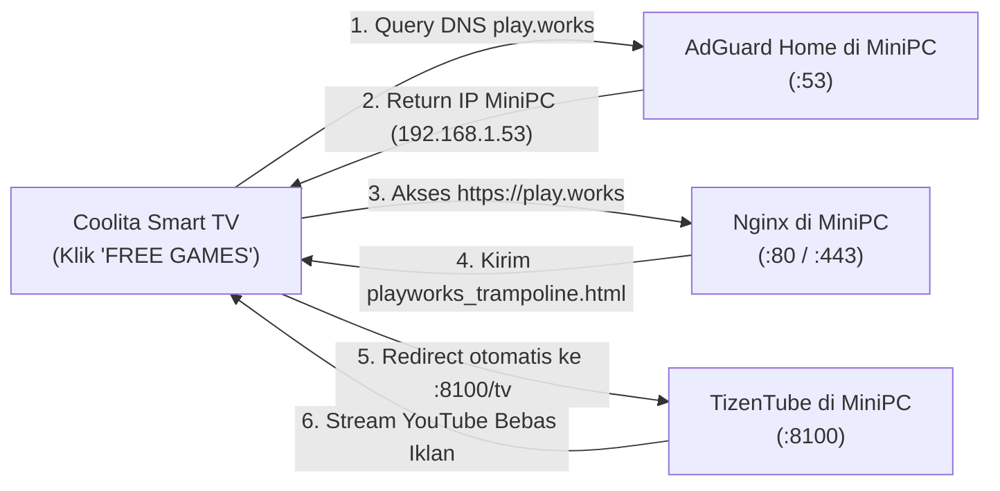

# Panduan Lengkap: Integrasi Coolita OS Smart TV dengan TizenTube (Ad-Free YouTube TV)

Panduan ini khusus untuk topologi sederhana: **Hanya MiniPC (Linux) dan TV Coolita OS**. 
Seluruh service (DNS Server, Web Trampoline, dan TizenTube Proxy) berjalan langsung di dalam satu unit **MiniPC**.

Sebagian code diambil dari github TizenTubeCobalt : https://github.com/reisxd/TizenTubecobalt

---

## 1. Topologi & Kebutuhan Perangkat

Hanya membutuhkan 2 perangkat dalam jaringan Wi-Fi/LAN rumah yang sama:

* **1. MiniPC (Server Linux - Ubuntu/Debian)**: IP statis `192.168.1.53`
  * **AdGuard Home** (Port `53` DNS & Port `3000` Web UI): Menjadi DNS server lokal untuk TV.
  * **Nginx Web Server** (Port `80` & `443` HTTPS): Melayani sertifikat SSL & halaman trampoline redirect.
  * **TizenTube Node.js** (Port `8100`): Engine proxy YouTube TV bebas iklan + SponsorBlock.
* **2. Smart TV Coolita OS (Coocaa / Skyworth)**: IP `192.168.1.232` (atau DHCP apapun)
  * DNS pada pengaturan TV diarahkan ke IP MiniPC: `192.168.1.53`.



---

## 2. Mengapa Memakai Card "FREE GAMES" (Bukan Tombol YouTube Remote)?

1. **Tombol Remote YouTube Fisik**:
   * Menjalankan binary native **Google Cobalt**.
   * Menerapkan **TLS Certificate Pinning** bawaan Google.
   * Jika domain YouTube dibelokkan ke server lokal, TV menolak sertifikat SSL dan langsung **layar hitam (blank screen)**.
2. **Card Menu "FREE GAMES" di Layar TV**:
   * Berjalan di atas browser **Chromium H5 Web Card** (Chrome 103 Engine).
   * **Tidak menerapkan TLS certificate pinning**, sehingga menerima sertifikat SSL lokal MiniPC.
   * Begitu card ditekan, script trampoline langsung me-redirect browser TV ke antarmuka TizenTube.
   * Remote TV (D-pad navigasi, OK, Volume, dan tombol BACK) berfungsi normal.

---

## 3. Langkah 1: Setup TizenTube di MiniPC

TizenTube berjalan di port `8100` untuk mem-proxy antarmuka Web YouTube TV (`https://www.youtube.com/tv`) dan menginjeksi ad-blocker.

### 3.1. Install Dependensi & yt-dlp
Jalankan di terminal MiniPC:
```bash
sudo apt-get update
sudo apt-get install -y curl git python3 ffmpeg

# Install Node.js v20 LTS
curl -fsSL https://deb.nodesource.com/setup_20.x | sudo bash -
sudo apt-get install -y nodejs

# Install yt-dlp binary
sudo curl -L https://github.com/yt-dlp/yt-dlp/releases/latest/download/yt-dlp -o /usr/local/bin/yt-dlp
sudo chmod a+rx /usr/local/bin/yt-dlp
```

### 3.2. Siapkan Folder & Service TizenTube
```bash
sudo mkdir -p /opt/tizentube
cd /opt/tizentube
```

Buat `/opt/tizentube/package.json`:
```json
{
  "name": "tizentube",
  "version": "1.0.0",
  "main": "server.js",
  "dependencies": {
    "express": "^5.3.0",
    "node-fetch": "^2.7.0"
  }
}
```

Install library Node:
```bash
npm install
```

Pastikan file `server.js` dan `userScript.js` sudah ditaruh di dalam `/opt/tizentube/`.

### 3.3. Pasang Systemd Service
Buat file `/etc/systemd/system/tizentube.service`:
```ini
[Unit]
Description=TizenTube Ad-Free YouTube Proxy for Smart TV
After=network.target

[Service]
Type=simple
User=root
WorkingDirectory=/opt/tizentube
ExecStart=/usr/local/bin/node --max-http-header-size=131072 /opt/tizentube/server.js
Restart=always
RestartSec=3
Environment=NODE_ENV=production

[Install]
WantedBy=multi-user.target
```

Nyalakan service:
```bash
sudo systemctl daemon-reload
sudo systemctl enable tizentube
sudo systemctl start tizentube
```

---

## 4. Langkah 2: Setup Sertifikat SSL di MiniPC

TV Coolita membuka card Free Games melalui protokol HTTPS. Nginx membutuhkan sertifikat SSL untuk domain tersebut.

Jalankan perintah ini di MiniPC:
```bash
sudo mkdir -p /etc/nginx/ssl

sudo openssl req -x509 -nodes -days 3650 -newkey rsa:2048 \
  -keyout /etc/nginx/ssl/my.key \
  -out /etc/nginx/ssl/my.crt \
  -subj "/CN=play.works" \
  -addext "subjectAltName=DNS:play.works,DNS:*.play.works,DNS:service.play.works,DNS:app.365qtv.com"
```

---

## 5. Langkah 3: Setup Nginx Trampoline di MiniPC

Nginx bertugas menyambut request yang datang ke `play.works` dan me-redirect browser TV ke TizenTube port `8100`.

### 5.1. File HTML Trampoline (`/var/www/html/playworks_trampoline.html`)
```bash
sudo tee /var/www/html/playworks_trampoline.html > /dev/null << 'EOF'
<!DOCTYPE html>
<html>
<head>
<meta charset="utf-8">
<title>TizenTube</title>
<script>
window.location.replace("http://192.168.1.53:8100/tv");
</script>
<meta http-equiv="refresh" content="0; url=http://192.168.1.53:8100/tv">
</head>
<body style="background:#000; color:#ff0000; display:flex; align-items:center; justify-content:center; height:100vh; margin:0; font-family:sans-serif;">
<div style="text-align:center;">
    <h2 style="font-size:32px; margin-bottom:10px;">Membuka TizenTube...</h2>
    <p style="color:#aaa; font-size:18px;">YouTube Bebas Iklan</p>
</div>
</body>
</html>
EOF
```
*(Ganti `192.168.1.53` jika IP MiniPC Anda berbeda).*

### 5.2. File PHP Proxy (`/var/www/html/game_proxy.php`)
```bash
sudo tee /var/www/html/game_proxy.php > /dev/null << 'EOF'
<?php
$host = $_SERVER["HTTP_HOST"] ?? "app.365qtv.com";
$uri = $_SERVER["REQUEST_URI"] ?? "/";
$server_ip = "192.168.1.53";

if ($host === "app.365qtv.com" && (strpos($uri, "/game") !== false || $uri === "/")) {
    header("Content-Type: text/html; charset=utf-8");
    echo "<!DOCTYPE html>\n<html>\n<head>\n<meta charset=\"utf-8\">\n<title>TizenTube</title>\n";
    echo "<script>window.location.replace(\"http://{$server_ip}:8100/tv\");</script>\n";
    echo "<meta http-equiv=\"refresh\" content=\"0; url=http://{$server_ip}:8100/tv\">\n";
    echo "</head>\n<body style=\"background:#000; color:#ff0000; display:flex; align-items:center; justify-content:center; height:100vh; margin:0; font-family:sans-serif;\">\n";
    echo "<h2 style=\"font-size:32px;\">Membuka TizenTube...</h2>\n</body>\n</html>\n";
    exit;
}

$upstream_ip = "47.88.59.46";
$ch = curl_init("http://{$upstream_ip}{$uri}");
curl_setopt($ch, CURLOPT_RETURNTRANSFER, true);
curl_setopt($ch, CURLOPT_TIMEOUT, 10);
curl_setopt($ch, CURLOPT_FOLLOWLOCATION, true);
$body = curl_exec($ch);
$http_code = curl_getinfo($ch, CURLINFO_HTTP_CODE);
$content_type = curl_getinfo($ch, CURLINFO_CONTENT_TYPE);
curl_close($ch);

if ($content_type) header("Content-Type: $content_type");
http_response_code($http_code ?: 200);
echo $body;
EOF
```

### 5.3. Konfigurasi Nginx Virtual Hosts
Buat file `/etc/nginx/sites-available/playworks`:
```nginx
server {
    listen 80;
    listen 443 ssl;
    server_name play.works service.play.works *.play.works;

    ssl_certificate /etc/nginx/ssl/my.crt;
    ssl_certificate_key /etc/nginx/ssl/my.key;

    root /var/www/html;
    index index.html;

    add_header Cache-Control "no-store, no-cache, must-revalidate, max-age=0" always;
    add_header Pragma "no-cache" always;
    add_header Expires "0" always;

    # Intersepsi SDK Playworks
    location = /service/sdk/tgh5.min.js {
        default_type application/javascript;
        return 200 "window.location.replace('http://192.168.1.53:8100/tv');";
    }

    # Intersepsi Halaman Depan
    location / {
        try_files /playworks_trampoline.html =200;
    }

    location ~ \.php$ {
        include snippets/fastcgi-php.conf;
        fastcgi_pass unix:/var/run/php/php7.4-fpm.sock;
    }
}
```

Buat file `/etc/nginx/sites-available/freegames`:
```nginx
server {
    listen 80;
    listen 443 ssl;
    server_name app.365qtv.com;

    ssl_certificate /etc/nginx/ssl/my.crt;
    ssl_certificate_key /etc/nginx/ssl/my.key;

    root /var/www/html;

    location / {
        fastcgi_pass unix:/var/run/php/php7.4-fpm.sock;
        include fastcgi_params;
        fastcgi_param SCRIPT_FILENAME /var/www/html/game_proxy.php;
        fastcgi_param SCRIPT_NAME /game_proxy.php;
        fastcgi_param REQUEST_URI $request_uri;
        fastcgi_param REQUEST_METHOD $request_method;
        fastcgi_param HTTP_HOST $http_host;
    }
}
```

Aktifkan kedua vhost dan restart Nginx:
```bash
sudo ln -sf /etc/nginx/sites-available/playworks /etc/nginx/sites-enabled/
sudo ln -sf /etc/nginx/sites-available/freegames /etc/nginx/sites-enabled/
sudo nginx -t
sudo systemctl restart nginx
```

---

## 6. Langkah 4: Setup DNS di AdGuard Home (MiniPC)

Karena AdGuard Home berjalan di MiniPC itu sendiri, kita tinggal menambahkan aturan DNS rewrite agar domain card game menunjuk ke IP MiniPC.

1. Buka antarmuka AdGuard Home di browser: `http://192.168.1.53:3000`.
2. Masuk ke menu **Filters** $\rightarrow$ **DNS rewrites** (atau **Custom filtering rules**).
3. Tambahkan 3 rule berikut:
   ```text
   ||play.works^$dnsrewrite=192.168.1.53
   ||service.play.works^$dnsrewrite=192.168.1.53
   ||app.365qtv.com^$dnsrewrite=192.168.1.53
   ```
4. Klik **Save / Apply**.

> [!TIP]
> Jika AdGuard Home digunakan bersama oleh banyak perangkat di rumah dan Anda **hanya ingin TV Coolita** yang dibelokkan, tambahkan pembatasan IP TV:
> ```text
> ||play.works^$dnsrewrite=192.168.1.53,client=192.168.1.232
> ||service.play.works^$dnsrewrite=192.168.1.53,client=192.168.1.232
> ||app.365qtv.com^$dnsrewrite=192.168.1.53,client=192.168.1.232
> ```

---

## 7. Langkah 5: Konfigurasi Jaringan pada TV Coolita

Agar pembelokan domain berfungsi, TV Coolita harus menggunakan MiniPC sebagai DNS resolver-nya:

1. Nyalakan TV Coolita.
2. Buka **Settings (Pengaturan)** $\rightarrow$ **Network (Jaringan)**.
3. Pilih koneksi Anda (Wi-Fi atau Kabel LAN).
4. Ubah pengaturan IP dari **DHCP** ke **Static (Manual)**:
   * **IP Address**: Tetap isi IP TV saat ini (contoh: `192.168.1.232`)
   * **Subnet Mask**: `255.255.255.0`
   * **Gateway**: IP Router rumah Anda (contoh: `192.168.1.1`)
   * **DNS 1 (Primary DNS)**: **`192.168.1.53`** *(IP MiniPC)*
   * **DNS 2 (Secondary DNS)**: `1.1.1.1` atau `8.8.8.8` (opsional)
5. Simpan pengaturan.

---

## 8. Langkah 6: Uji Coba

1. Pada TV Coolita, kembali ke layar utama (Home Launcher).
2. Geser remote ke card menu **FREE GAMES** lalu tekan **OK**.
3. Di layar TV akan muncul sebentar teks: *"Membuka TizenTube..."*.
4. Dalam beberapa detik, antarmuka **YouTube on TV** akan langsung terbuka.
5. Jalankan video:
   * Video berputar lancar tanpa iklan.
   * Remote TV D-pad dan tombol **BACK** berfungsi normal.
