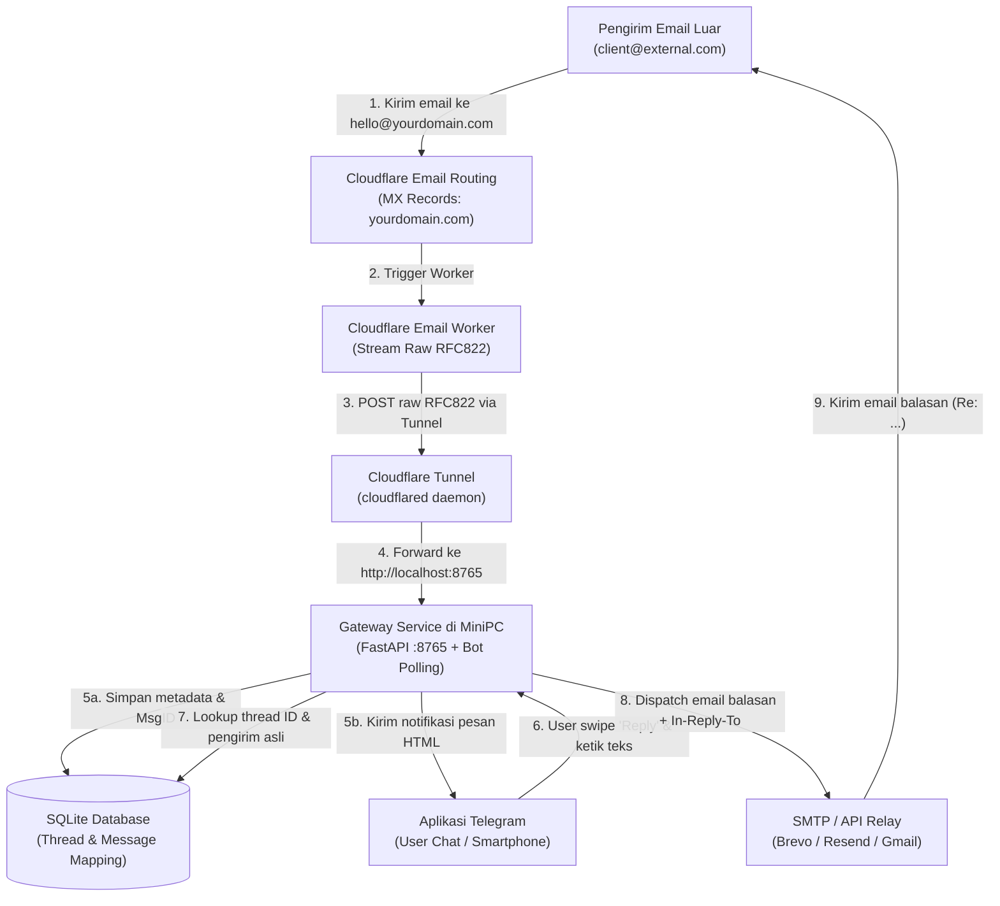

# 📬 Mail-to-Telegram Gateway

Solusi self-hosted dua arah (2-Way) untuk menerima dan membalas email domain pribadi langsung melalui Telegram tanpa perlu membuka port 25 di server lokal / MiniPC dan tanpa perlu menjalankan mail server penuh (Postfix/Dovecot).


---

## ✨ Fitur Utama

- **Zero Port Opening:** Tidak perlu buka port 25, 587, atau 80/443 di router / modem (aman dari blokir ISP dan IP dinamis).
- **2-Way Communication:** Baca email masuk di Telegram, dan langsung balas (**swipe reply**) dari Telegram.
- **Header Threading Asli:** Email balasan menyertakan header `In-Reply-To` dan `References` standar RFC, sehingga di sisi penerima akan masuk dalam satu percakapan (thread).
- **Zero-Dependency Cloudflare Worker:** Cloudflare Worker murni vanilla JS tanpa proses build / npm `wrangler`, meneruskan stream raw RFC822 ke server lokal.
- **Python Native RFC822 Parsing:** Parsing MIME, charset decoding, multipart, plain text & HTML dilakukan di sisi server lokal.
- **Dockerized:** Siap jalan dalam satu perintah `docker compose up -d`.

---

## 📁 Struktur Direktori

```text
mail-to-tele/
├── docker-compose.yml       # Definisi service Docker
├── Dockerfile               # Python 3.11-slim container
├── requirements.txt         # Dependensi Python
├── main.py                  # Core logic FastAPI + Telegram Bot + SMTP
├── .env.example             # Template konfigurasi environment
├── cloudflare_worker.js     # Script Cloudflare Email Worker
└── README.md                # Dokumentasi proyek
```

---

## 🚀 Panduan Instalasi Langkah-demi-Langkah

### 1. Persiapan Bot Telegram

1. Buka Telegram, cari bot **[@BotFather](https://t.me/BotFather)**.
2. Kirim `/newbot`, ikuti panduan dan simpan token bot (misal: `123456789:ABCdefGHIjklMNOpqrsTUVwxyz`).
3. Cari **[@userinfobot](https://t.me/userinfobot)** untuk mengetahui Telegram User ID Anda (misal: `123456789`).

---

### 2. Setup Server Lokal / MiniPC

Clone atau buat folder proyek di server / MiniPC Anda:

```bash
mkdir -p mail-to-tele && cd mail-to-tele
```

Salin file `docker-compose.yml`, `Dockerfile`, `requirements.txt`, `main.py`, dan `.env.example`.

Salin template environment:
```bash
cp .env.example .env
nano .env
```

Sesuaikan konfigurasi `.env`:
```ini
# Telegram Configuration
TELEGRAM_BOT_TOKEN=123456789:ABCdefGHIjklMNOpqrsTUVwxyz
TELEGRAM_CHAT_ID=123456789

# Secret Token untuk keamanan komunikasi Cloudflare -> MiniPC
WEBHOOK_SECRET=buat_random_secret_string_di_sini

# Identitas Email Pengirim (Domain Anda)
MAIL_FROM=hello@yourdomain.com

# Outbound Email Provider (Pilih Opsi A atau Opsi B)
# Opsi A: Resend API (https://resend.com - gratis 3.000 email/bln)
RESEND_API_KEY=

# Opsi B: SMTP Relay (Brevo / Sendinblue / Gmail App Password)
SMTP_HOST=smtp-relay.brevo.com
SMTP_PORT=587
SMTP_USER=your_login_id@smtp-brevo.com
SMTP_PASS=your_smtp_key_password
SMTP_USE_TLS=true
```

> [!IMPORTANT]
> **Catatan Penting Brevo (Sendinblue):**
> 1. Di menu Brevo **SMTP & API**, perhatikan nilai **Login / Username**. Seringkali username SMTP Brevo berbentuk `xxxxxx@smtp-brevo.com`, bukan alamat email login akun Anda.
> 2. Di pengaturan Brevo, pastikan fitur **Authorized IPs** mengizinkan IP server Anda atau matikan proteksi IP whitelist jika server berada di IP dinamis.

Build dan jalankan container:
```bash
docker compose up -d --build
```

Periksa log container:
```bash
docker compose logs -f
```
Jika berhasil, akan muncul:
```text
[INFO] mail-tg-gateway: Telegram Bot polling started successfully.
INFO: Uvicorn running on http://0.0.0.0:8765
```

---

### 3. Setup Cloudflare Tunnel (`cloudflared`)

Agar Cloudflare dapat meneruskan data ke MiniPC tanpa port forwarding:

1. Edit konfigurasi `cloudflared` (biasanya di `/etc/cloudflared/config.yml`):
   ```yaml
   ingress:
     # Tambahkan subdomain webhook sebelum wildcard / default rule
     - hostname: mail-hook.yourdomain.com
       service: http://127.0.0.1:8765
     - hostname: '*.yourdomain.com'
       service: https://localhost:443
     - service: http_status:404
   ```

2. Restart service tunnel:
   ```bash
   sudo systemctl restart cloudflared
   ```

3. Di **Cloudflare Dashboard** $\rightarrow$ **DNS**:
   - Tambahkan CNAME: `mail-hook` $\rightarrow$ `<tunnel-uuid>.cfargotunnel.com` (Status: **Proxied** / Orange Cloud).

---

### 4. Setup Cloudflare Email Worker & Routing

1. **Buat Worker**:
   - Masuk ke Cloudflare Dashboard $\rightarrow$ **Workers & Pages** $\rightarrow$ **Create application** $\rightarrow$ tab **Workers**.
   - Klik **Create Worker** (template Hello World) $\rightarrow$ klik **Deploy**.
   - Setelah ter-deploy, klik tombol **Edit code**.
   - Hapus semua baris kode bawaan, lalu paste isi file `cloudflare_worker.js`:
     ```javascript
     export default {
       async email(message, env, ctx) {
         try {
           const rawEmail = await new Response(message.raw).arrayBuffer();
           const webhookUrl = env.MINIPC_WEBHOOK_URL || 'https://mail-hook.yourdomain.com/api/incoming-raw';
           const secret = env.WEBHOOK_SECRET || '';

           const resp = await fetch(webhookUrl, {
             method: 'POST',
             headers: {
               'Content-Type': 'message/rfc822',
               'X-Webhook-Secret': secret,
               'X-Mail-From': message.from,
               'X-Mail-To': message.to
             },
             body: rawEmail
           });

           if (!resp.ok) {
             const errText = await resp.text();
             console.error(`Gagal forward ke MiniPC (${resp.status}): ${errText}`);
           } else {
             console.log(`Email dari ${message.from} berhasil dikirim ke MiniPC`);
           }
         } catch (err) {
           console.error('Error pada Email Worker:', err);
         }
       }
     };
     ```
   - Klik **Deploy**.

2. **Atur Environment Variables Worker**:
   - Buka Worker tersebut $\rightarrow$ **Settings** $\rightarrow$ **Variables and Secrets**.
   - Tambahkan:
     - `MINIPC_WEBHOOK_URL` = `https://mail-hook.yourdomain.com/api/incoming-raw`
     - `WEBHOOK_SECRET` = (samakan dengan nilai `WEBHOOK_SECRET` di file `.env`)

3. **Konfigurasi Email Routing**:
   - Buka menu domain Anda di Cloudflare $\rightarrow$ **Email Routing**.
   - Aktifkan fitur Email Routing (Cloudflare akan menambahkan DNS MX otomatis).
   - Masuk ke tab **Routing Rules** $\rightarrow$ klik **Create rule**:
     - **Custom address**: `hello` @ `yourdomain.com` (atau email yang diinginkan).
     - **Action**: `Send to Worker` $\rightarrow$ pilih Worker yang baru dibuat di atas.
     - Simpan perubahan (**Save**).

---

## 🧪 Uji Coba Sistem

### 1. Uji Coba Inbound (Simulasi Email Masuk)
Jalankan perintah ini di server Anda untuk menguji apakah bot mengirim notifikasi ke Telegram:

```bash
curl -X POST http://127.0.0.1:8765/api/incoming-raw \
  -H "Content-Type: message/rfc822" \
  -H "X-Webhook-Secret: buat_random_secret_string_di_sini" \
  -H "X-Mail-From: pengirim@example.com" \
  -H "X-Mail-To: hello@yourdomain.com" \
  --data-binary $'From: Pengirim <pengirim@example.com>\r\nTo: hello@yourdomain.com\r\nSubject: Test Email Gateway\r\nMessage-ID: <test-001@example.com>\r\n\r\nHalo! Ini pesan uji coba integrasi Telegram.'
```

Pesan akan langsung muncul di Telegram dengan format:
```text
📬 Email Masuk Baru
━━━━━━━━━━━━━━━━━━━━
👤 Dari: pengirim@example.com
🎯 Ke: hello@yourdomain.com
📝 Subjek: Test Email Gateway
━━━━━━━━━━━━━━━━━━━━

Halo! Ini pesan uji coba integrasi Telegram.

💡 Swipe / Reply pesan ini di Telegram untuk membalas ke pengirim.
```

### 2. Uji Coba Outbound (Balas Langsung dari Telegram)
1. **Swipe / Reply** pesan notifikasi tersebut di Telegram.
2. Ketik balasan Anda (contoh: `Terima kasih, pesan sudah diterima`).
3. Kirim. Bot akan membalas dengan status: `✅ Email Sent!` ke pengirim asli.

---

## ❓ FAQ & Troubleshooting

### Mengapa saat update `.env` konfigurasi tidak berubah?
`docker compose restart` tidak membaca ulang file `.env`. Jalankan perintah berikut agar environment baru dimuat:
```bash
docker compose up -d --force-recreate
```

### Error `535 5.7.8 Authentication failed` pada Brevo?
- Pastikan `SMTP_USER` diisi dengan username SMTP yang tertera di menu **SMTP & API** Brevo (biasanya berformat `xxxx@smtp-brevo.com`).
- Pastikan IP server lokal sudah terdaftar di whitelist IP Brevo atau fitur IP whitelist dinonaktifkan.

### Alternatif SMTP selain Brevo?
- **Resend API**: Sangat direkomendasikan karena berbasis HTTP REST API (bebas masalah blokir port SMTP & IP whitelist). Cukup masukkan `RESEND_API_KEY`.
- **Gmail App Password**: Gratis hingga 500 email/hari. Gunakan `smtp.gmail.com` port `587` dengan 16-digit App Password dari akun Google Anda.

---

## 📄 Lisensi
MIT License. Bebas digunakan dan dimodifikasi untuk keperluan pribadi maupun komersial.
